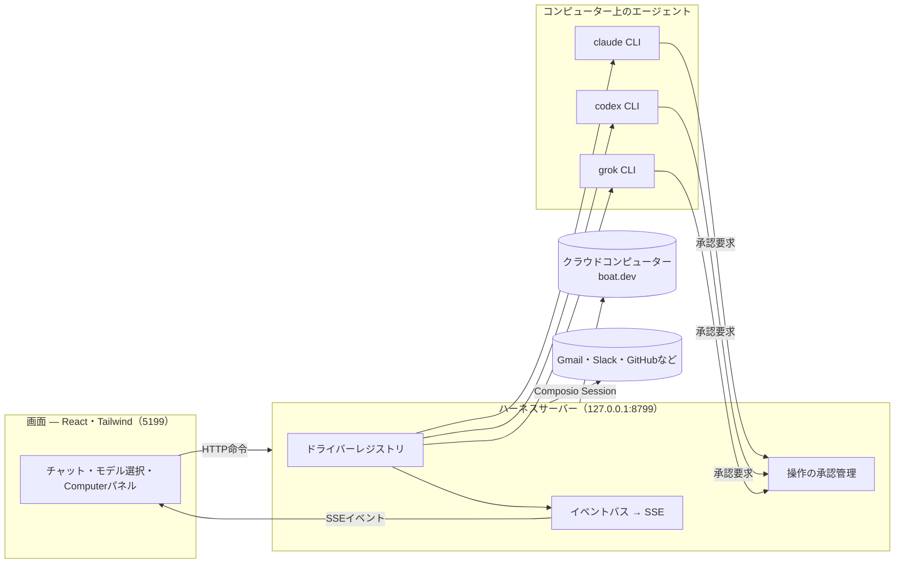

# OpenMausBot Personal

複数のAIエージェントを、チャットアプリから使うための個人用フォークです。[OpenMausBot](https://github.com/milind-soni/OpenMausBot)をもとに、Mac向けの機能を追加しています。

ボットごとにモデルや役割を選び、会話、ファイル操作、接続したアプリの作業を依頼できます。CodexやClaudeなどのエージェントは、接続先のCLIやサービス上で動きます。重要な操作はチャット内の承認カードで確認できます。

## このフォークで追加した機能

- **NativeConect**：OMBから既存のCodexやOhMyPiのセッションへ指示を送り、履歴と出力を読み取ります。仲介モデルによる入力の整理と、OMBに表示する回答の短縮を分けています。接続方式ごとの対応範囲は[NativeConect](docs/nativeconect.md)、[Codex接続](docs/verification/direct-codex.md)、[OhMyPi接続](docs/verification/native-omp.md)を参照してください。
- **登録語句の置換と復元**：漢字・かな・英語などの表記を同じ仮名へ置き換え、指定した表記で表示を復元できます。OpenAI privacy-filterによる自動検出は削除済みです。未登録の個人情報は検出しません。[置換機能の範囲](docs/privacy-filter.md)
- **グループごとの権限**：メンバーごとに応答・投稿・メンション・連携の権限を設定し、カテゴリーをまたいだ協力を許可できます。[設定と検証](docs/verification/group-permissions.md)
- **入力・送信キーの設定**：Personal版の既定はEnterで送信・キュー、Shift+Enterで改行、Cmd+Enterで実行中の会話への差し込みです。設定から変更できます。[入力キーの仕様](docs/verification/personal-tool-privacy.md#composer)
- **Google Chat連携**：指定した会話の新着を受け取り、登録語句をこのMacで置換します。受信だけで返信は送りません。[設定と制約](docs/google-chat.md)
- **Macアプリの更新**：固定ランチャーと更新用ランタイムを分け、通常の更新ではランチャーを置き換えません。署名の変更に伴うキーチェーンの再確認を減らす構成です。[Personal版の起動・認証・更新](docs/personal-app.md)

Personal版の設定・会話は `~/.openmausbot-personal/` に保存します。上流版の保存先 `~/.openmausbot/` とは別です。スマホや別のPCからは、動作中のホストへペアリングして接続します。

以下のダウンロード先と一般機能の説明は上流版のものです。上流の配布アプリやnpmパッケージには、このフォーク独自の変更は含まれません。Personal版の起動・ビルド手順は[専用ガイド](docs/personal-app.md)を参照してください。

<div align="center">

## OpenMausBot

**AIボットのチームを、ひとつのチャットアプリで。**

[公式サイト](https://www.openmausbot.com) · [上流版のダウンロード](https://www.openmausbot.com/download) · [Grok Botとの比較](https://www.openmausbot.com/blog/grok-bot-vs-openmausbot)

<sub>Grok Botに着想を得た独立したオープンソースプロジェクトです。MausBotとも呼ばれ、以前はOpenGrokBotという名称でした。xAI、Meta、OpenAI、Manusとは提携していません。</sub>


[](https://github.com/milind-soni/OpenMausBot/releases/latest)


<br>

<a href="https://github.com/milind-soni/OpenMausBot/releases/latest/download/OpenMausBot.dmg">
  
</a>
&nbsp;
<a href="https://github.com/milind-soni/OpenMausBot/releases/latest/download/OpenMausBot-intel.dmg">
  
</a>
&nbsp;
<a href="https://github.com/milind-soni/OpenMausBot/releases/latest/download/OpenMausBot-setup.exe">
  
</a>
&nbsp;
<a href="https://github.com/milind-soni/OpenMausBot/releases/latest/download/OpenMausBot-amd64.deb">
  
</a>

<sub>[上流の最新リリース](https://github.com/milind-soni/OpenMausBot/releases/latest) &nbsp;·&nbsp; macOS：Apple silicon・Intel、署名・公証済みDMG &nbsp;·&nbsp; Windows：x64インストーラー &nbsp;·&nbsp; Ubuntu 24.04 x64：DEB・AppImageのベータ版 &nbsp;·&nbsp; [上流のリリース一覧](https://github.com/milind-soni/OpenMausBot/releases)</sub>

<br>

<a href="https://github.com/sponsors/milind-soni">
  
</a>

<br>
<br>

<sub>協賛： <a href="https://boat.dev">boat.dev</a></sub>
<br>
<a href="https://boat.dev">
  <picture>
    <source media="(prefers-color-scheme: dark)" srcset="docs/assets/sponsors/boat-logo-white.svg">
    
  </picture>
</a>

<br>
<br>


</div>

> OpenMausBotは暗号資産と関係ありません。プロジェクトのトークンはありません。OpenMausBot、Maus、SupaMausの名前を使うコインは、上流プロジェクトやそのメンテナーが作成・承認したものではありません。上流メンテナーは、トークン・報酬・割当を受け取っておらず、トークンを推奨しないと表明しています。

## OpenMausBotの考え方

AIを連絡先のように扱い、用途に応じたボットへ作業を依頼します。ボットごとに役割、会話の履歴、モデル、作業用コンピューター、接続アプリを持たせられます。

- インストール済みの `claude`、`codex`、`grok` CLIと、そのログイン・契約を利用できます。独自のCLIやラッパーは「設定 → エンジン」で指定できます。
- ローカルのハーネスサーバーがエージェントのプロセスを管理します。上流版の会話履歴・設定・イベントは `~/.openmausbot/` に保存されます。AIへの推論依頼や接続サービスとの通信は外部へ送られるため、ローカル保存は外部送信を行わないという意味ではありません。
- クラウドのLinuxデスクトップ、隔離したLocal VM、対応環境ではホスト自身を操作できます。ホスト操作には明示的な有効化が必要です。macOSとUbuntu Xorgが対応し、Ubuntu Waylandのホスト操作は問題[#345](https://github.com/milind-soni/OpenMausBot/issues/345)への対応中のため無効です。Composio経由で500以上のアプリにも接続できます。

## 類似サービスとの比較

上流では、Grok Bot、Meta Muse、OpenAI dots、Cue by Manus、Instinct AIとの比較を公開しています。OpenMausBotは、ボットごとにモデルやコンピューターを選び、自分のマシンで動かせる構成を採っています。各サービスの提供地域・料金・利用条件は変更されることがあるため、比較記事と各サービスの公式情報を確認してください。

| 比較対象 | 上流READMEで紹介されている構成 | OpenMausBotで選べる構成 | 比較記事 |
| --- | --- | --- | --- |
| Grok Bot | Grokを使う複数のボットがクラウドのコンピューターを共有 | ボットごとにモデルを選択し、自分のマシンで実行。承認カードで操作を確認 | [Grok Botとの比較](https://www.openmausbot.com/blog/grok-bot-vs-openmausbot) |
| Meta Muse | MetaのクラウドVM上で動く単体のパーソナルエージェント | 複数のエージェントを使い、データをローカルに保存 | [Meta Museとの比較](https://www.openmausbot.com/blog/open-source-alternative-to-meta-muse) |
| OpenAI dots | ChatGPT内で動く常時稼働型のGPTエージェント | Claude・ChatGPT・Grokなどのログインを使い分ける。OpenMausBot専用プランは不要 | [OpenAI dotsとの比較](https://www.openmausbot.com/blog/openai-dots-alternative) |
| Cue by Manus | 専用の電話・メール・ウォレットを持つ招待制エージェント | 招待不要。対応する連携ではOAuthを利用 | [Cue by Manusとの比較](https://www.openmausbot.com/blog/open-source-alternative-to-cue-by-manus) |
| Instinct AI | クラウドのコンピューターでパスワードを扱う招待制エージェント | 自分のマシンで動かし、必要な操作を承認。対応する連携ではOAuthを利用 | [Instinct AIとの比較](https://www.openmausbot.com/blog/instinct-ai-alternative) |

[5サービスの比較](https://www.openmausbot.com/blog/muse-vs-grok-bot-vs-dots-vs-cue)と、[用途に応じた選び方](https://www.openmausbot.com/blog/which-ai-agent-should-i-use)も公開されています。AIプロバイダーやクラウドサービスの契約・料金は別途必要になる場合があります。

## 主な機能

<table>
<tr>
<td width="50%" valign="top">

### ボットごとにモデルを選ぶ

モデル選択画面にClaudeやCodexなどのプロバイダーを表示します。既定のモデルや、利用できない理由も確認できます。会話の途中でモデルを切り替えられます。


</td>
<td width="50%" valign="top">

### 作業用コンピューターを使う

Computerパネルからクラウドのデスクトップを起動し、作業中の画面を確認できます。「Open desktop」でブラウザから操作を引き継げます。対応環境では自分のMacも操作先にできます。


</td>
</tr>
<tr>
<td width="50%" valign="top">

### 操作をチャット内で承認する

シェルコマンド、ファイル編集、確認事項をカードで表示します。承認が必要な操作にはAllow／Denyで答えます。承認の範囲はボットの権限設定によって変わります。


</td>
<td width="50%" valign="top">

### アプリと接続する

Composio Sessionsの接続画面から、Gmail、Slack、GitHub、Notion、Linearなどを登録できます。OAuthで認証した接続を、ボットのツールとして使います。


</td>
</tr>
<tr>
<td width="50%" valign="top">

### ボットをチャットのように管理する

右クリックからピン留め、未読への変更、プロフィール編集、複製、会話IDのコピー、非表示、削除を行えます。


</td>
<td width="50%" valign="top">

### 接続情報をまとめて設定する

設定画面からAPIキーなどを登録できます。接続情報はローカルに保存され、プロバイダーの設定へ反映されます。画面には秘密の値を返さず、設定済みかどうかを表示します。


</td>
</tr>
</table>

### 用途ごとにチャンネルを分ける

仕事、個人用、プロジェクトごとにチャンネルを作れます。同じボットを複製する必要はありません。チャンネルごとに履歴、共通指示、作業フォルダー、応答ルール、参加ボットを設定できます。チャンネル名やメンバーはあとから変更できます。

### 応答するボットを自動で選ぶ

「設定 → 判断モデル」でTypeSafe Jevのキー、またはOpenRouterのキーとモデルを登録すると、Autoに設定した部屋で、メンションのない発言への応答者を選びます。判断モデルが無効な場合や選択できない場合は、その部屋のリードが応答します。[判断モデルの説明](docs/decision-model.md)

### Markdownファイルからチームを作る

[BotMRR](https://botmrr.io)でチームを選び、「Add to OpenMausBot」から取り込めます。作成前の確認画面で、ボット、チーフ・オブ・スタッフ、チャンネル、手順書、接続先のチェックリスト、定期実行の提案を確認します。「Teams → Import」ではローカルの `.md` ファイルや公開GitHub URLも指定できます。

YAMLフロントマターを読み取ってチームを作成し、本文のMarkdownはGrok、Claude、ChatGPTや人間も手順書として読めます。接続は承認まで無効、定期実行は一時停止の状態で取り込みます。認証情報、会話履歴、権限、記憶、コンピューターへのアクセス権はパッケージに含みません。[チームのリポジトリ](https://github.com/milind-soni/openmausbot-teams)と[ファイル形式](https://github.com/milind-soni/openmausbot-teams/blob/main/FORMAT.md)を参照してください。

### チームを共有する

チームを右クリックして「Share team…」、または「Templates → Share」を選ぶと、チーム全体を1ファイルに保存できます。ボットの指示・画像・スキル、グループチャット、定期実行、共通指示、チーフ・オブ・スタッフ、接続先の枠、開始時のメモを含められます。メモを含めない場合はチェックを外します。保存前に内容を確認できます。

会話履歴、キー・パスワード、モデルの選択、コンピューターは含めません。テキスト中の秘密情報らしい文字列も除去しますが、共有前に内容を確認してください。取り込む側には新しいボットをAsk権限で作り、スキルを無効、定期実行を一時停止にします。[チーム共有](docs/team-sharing.md)

組織に接続したデスクトップでは「Templates → From {Organization}」からAdminが共有したパッケージを追加できます。この経路ではスキルを有効にして取り込みます。[組織ライブラリ](docs/org-library.md)

新しいボットの既定設定はプリセットとして共有できます。チームファイルへ含めるか、「Share as preset…」から単独で保存します。[プリセット](docs/presets.md)

### 音声で会話する

返答のスピーカーボタンから読み上げるほか、返答を順次読み上げる設定も使えます。通話では音声入力、作業状況の読み上げ、音声での承認を扱います。

ボットのプロフィールでElevenLabs、Fish Audio、Grok（xAI）、Mac標準音声、ローカルのChatterboxサーバーを選びます。クラウドの音声を使う場合は、対応サービスのAPIキーを登録してください。ボットごとに別の声を選べます。

Grokは「設定 → 接続」のxAI APIキーを使います。ボットの「Voice & alerts」で「Grok (xAI)」と声を選択すると、返答や通話用のMP3を生成します。言語は返答から自動判定します。[公式対応言語](https://docs.x.ai/developers/model-capabilities/audio/text-to-speech)以外では品質に差があります。これは読み上げの追加機能であり、マイクの文字起こし方式は変わりません。

ほかにも、返答のストリーミング、ツール実行状況の表示、macOSアプリでの端末内音声認識、役割に応じた表情のSupaMausカーソル、作業スクリーンショットの履歴表示があります。

## 使用している技術・サービス

<div align="center">


</div>

| 技術・サービス | 用途 |
| --- | --- |
| Claude・Codex・Grok | ローカルCLI経由でボットを実行 |
| Electron | macOS・Windows・Ubuntu向けデスクトップアプリ |
| React・Vite・Tailwind CSS | チャット画面とビルド |
| [Boat](https://boat.dev) | ボット用クラウドコンピューター。上流プロジェクトのスポンサー |
| Composio | Gmail、Slack、GitHubなどの接続アプリ |
| Cua Driver | ホストコンピューターの操作 |
| ElevenLabs・Fish Audio | クラウドでの音声合成 |
| GitHub Sponsors | 上流プロジェクトへの単発・月額支援 |

## 構成

基本構成は、画面を表示するアプリと、エージェントを管理するハーネスサーバーの2プロセスです。アプリはHTTPで命令を送り、SSEのイベントを受け取って表示を更新します。サーバーは各プロバイダー固有の通信を共通形式へ変換し、スレッドごとにNDJSONのイベントログへ記録します。



上図のポートはソースからの通常開発用です。Personalアプリの組み込みサーバーは既定で `127.0.0.1:8897` を使います。

| 層 | 場所 | 役割 |
| --- | --- | --- |
| ドライバー | `server/drivers/` | Claude、Codex、Grok BuildなどのローカルCLIやクラウドエージェントを接続。stream-JSON・JSON-RPC・ACPなどを扱います。不明なドライバーは利用不可として扱います。 |
| ハーネス | `server/harness/` | 設定から実行インスタンスを作るレジストリと、イベントの集約。 |
| API | `server/index.ts` | ボット、ターン、承認、モデル一覧、コンピューター、接続先、設定のHTTP・SSE API。 |
| 音声 | `server/tts/` | 各音声合成サービスと接続。クラウドのキーはサーバー側に保持し、読み上げ前にMarkdownを音声向けの文章へ整えます。 |
| アプリ | `src/` | サーバーの状態をチャット画面へ反映。 |
| デスクトップ | `electron/` | 組み込みサーバーとOS固有機能。Apple音声認識はmacOSのみ、Ubuntu Xorgのホスト操作は明示的な有効化が必要です。Waylandのホスト操作は無効です。 |

### MCPから操作する

Claude DesktopやCursorなどの外部クライアント向けに、stdioのMCPサーバーを提供します。ボット・チャンネルの確認、範囲を限定した履歴の閲覧・検索、ボット・チャンネル・タスクの作成と設定、仕事の送信、完了待ち、モデル切り替え、ターン中断を行えます。

承認の付与、削除、任意の設定変更、認証情報、コンピューターの起動・終了操作は公開しません。[MCPの設定とツール一覧](docs/mcp-server.md)

### スクリプトやCIから操作する

`openmausbot` コマンドで、起動中のワークスペースを画面なしで操作できます。ファイルからのチーム作成、仕事の依頼、依頼先とその協力先の完了待ち、成果物の出力に対応します。`--json` ではJSONを返し、終了コードでスクリプト側の処理を分岐できます。

```sh
openmausbot team apply team.yaml
openmausbot run "Room Lead" "https://example.com の公開前確認を行ってください" --export ./out
```

[スクリプト・CIでの使い方](docs/headless-cli.md)

## 起動する

### 上流の配布アプリ

配布版にはハーネスサーバーが組み込まれているため、別のサーバーを用意する必要はありません。以下は[上流のリリース](https://github.com/milind-soni/OpenMausBot/releases/latest)です。Personal版の独自機能は含みません。

| 環境 | ダウンロード | インストール |
| --- | --- | --- |
| macOS・Apple silicon | [OpenMausBot.dmg](https://github.com/milind-soni/OpenMausBot/releases/latest/download/OpenMausBot.dmg) | Applicationsへ移動して起動。上流配布版は署名・公証済みです。 |
| macOS・Intel | [OpenMausBot-intel.dmg](https://github.com/milind-soni/OpenMausBot/releases/latest/download/OpenMausBot-intel.dmg) | Intel Mac向け。上流配布版は署名・公証済みです。 |
| Windows・x64 | [OpenMausBot-setup.exe](https://github.com/milind-soni/OpenMausBot/releases/latest/download/OpenMausBot-setup.exe) | ユーザー単位でインストールし、管理者権限は不要です。未署名のため、SmartScreenで発行元不明の警告が表示されます。 |
| Ubuntu 24.04・x64 | [DEB](https://github.com/milind-soni/OpenMausBot/releases/latest/download/OpenMausBot-amd64.deb)・[AppImage](https://github.com/milind-soni/OpenMausBot/releases/latest/download/OpenMausBot.AppImage) | APTでDEBを導入する方法を推奨します。AppImageは実行権限を付けて起動します。ベータ版で、GNOMEを対応デスクトップとしています。 |

[Ubuntu向けガイド](docs/linux-desktop.md)に機能・制約・トラブルシューティングをまとめています。デスクトップアプリを、Tailscale経由で別のWindows・macOS・Ubuntuホストのクライアントとして使うこともできます。[PC同士の接続](docs/desktop-companion.md)

### このフォークのソースから起動する

macOS、Windows、Ubuntu 24.04 x64、Node.js 24以降、pnpmが必要です。実際に会話するには、[`claude`](https://claude.com/claude-code)、[`codex`](https://github.com/openai/codex)、[`grok`](https://x.ai/cli)などのCLIをインストールし、ログインしてください。利用可能なCLIはモデル選択画面に表示されます。

```sh
git clone https://github.com/SORALNV/OpenMausBotPersonal.git
cd OpenMausBotPersonal
pnpm install

# 別々のターミナルで実行
pnpm dev:server    # サーバー：127.0.0.1:8799
pnpm dev           # 画面：http://127.0.0.1:5199
pnpm dev:desktop   # Electron。上の2つも起動したままにする
```

この手順は通常の開発用起動です。Personal専用の保存先・認証分離・機能フラグを使うMacアプリのビルド・更新は[Personal版のガイド](docs/personal-app.md)に従ってください。通常の開発サーバーを既存のPersonalデータに向けて検証しないでください。

一般のデスクトップアプリは次のコマンドでパッケージ化します。

```sh
pnpm package:mac      # macOS：DMG・ZIP。Swift／Xcodeのツールが必要
pnpm package:win      # Windows：インストーラー・ZIP
pnpm package:linux    # Ubuntu x64：DEB・AppImage・検証済みCUAランタイム
```

### デスクトップ機能の対応状況

| 機能 | macOS | Ubuntu 24.04 Xorg | Ubuntu 24.04 Wayland |
| --- | --- | --- | --- |
| 配布アプリ・組み込みサーバー・ローカルCLI | 対応 | ベータ | ベータ |
| Composio・Boatなどのクラウドコンピューター | 対応 | ベータ | ベータ |
| ユーザーが明示的に始める画面プレビュー | 対応 | ベータ | ベータ |
| ボットによるホスト操作 | 対応 | ベータ、明示的な有効化が必要 | 無効。Waylandの安全性確認待ち |
| 端末内でのネイティブ音声入力 | 対応 | 予定 | 予定 |

Linuxの画面プレビューを開始しても、ホスト操作やAutoルーティングは有効になりません。Xorgでは明示的に有効化したあとにCua Driver 0.19.3を起動し、全画面のカーソルオーバーレイは使いません。Waylandでは起動せず、過去の有効化設定も解除します。会話、プレビュー、Cloud、Local VMは両方のセッションで利用できます。[Ubuntu向けガイド](docs/linux-desktop.md)と関連する問題[#29](https://github.com/milind-soni/OpenMausBot/issues/29)、[#345](https://github.com/milind-soni/OpenMausBot/issues/345)、[#113](https://github.com/milind-soni/OpenMausBot/issues/113)を参照してください。

Linux向けのビルドでは、タグを固定した上流アーカイブだけを取得し、サイズ、SHA-256、全ファイルの許可リスト、実行ファイルのハッシュを検証します。CLIとカーソルテーマの付属ファイルだけを組み込みます。導入済みアプリがネイティブ操作コードを自動ダウンロード・更新することはありません。CuaのMIT表記、InterのSIL OFL、依存ライセンス一覧、CycloneDXのソフトウェア部品表を同梱します。[来歴とライセンス](third_party/cua-driver/)

### 任意の接続情報

ローカルCLIとの会話に、以下の連携キーは必要ありません。連携を使うときに設定画面から登録してください。

| 接続情報 | 有効になる機能 | 入手先 |
| --- | --- | --- |
| Composioプロジェクトキー（`ak_…`） | Gmail、GitHub、Slack、Notionなどの連携 | [Composioの設定](docs/composio.md) |
| Boat APIキー | デスクトップと端末を備えた隔離Linuxコンピューター | [Boat APIキー](https://docs.boat.dev/api-keys) |
| ElevenLabsキー | 返答の読み上げ・通話 | [ElevenLabs APIキー](https://elevenlabs.io/app/settings/api-keys) |
| Fish Audioキー | Fish Audioの音声による読み上げ・通話 | [Fish Audio APIキー](https://fish.audio/app/api-keys/) |

ComposioとBoatは、独自のアカウント・利用規約を持つ外部サービスです。Boatは試用期間後に有料となり、クラウドコンピューターの利用で料金が発生する場合があります。

### 開発時の検証

```sh
pnpm typecheck       # 画面とサーバーの型検査
pnpm test            # 単体・ドライバー・API・デスクトップ機能のテスト
pnpm build           # 型検査と本番向けビルド
pnpm check:electron  # Electronのmain／preloadの構文検査
pnpm package:win     # Windowsインストーラー・ZIPをrelease/へ出力
pnpm package:linux   # Ubuntu x64向けDEB・AppImageをrelease/へ出力
```

サーバーや会話の変更を検証するときは、[検証手順](docs/verification/README.md)に従い、一時データと偽エンジンで起動してください。

## 定期実行・Webhook・アプリイベント

ボットへ「平日の9時に受信トレイを要約して」「フォームの通知が届いたら返信案を作って」と依頼すると、`create_trigger` で実行条件を作成します。作成時には追加の確認を行わず、チャットに編集・一時停止・取り消しのカードを表示します。

サイドバーの「Triggers」から、定期実行とWebhookの一覧、カレンダー、実行履歴を確認できます。ボットは `list_triggers`、`create_trigger`、`manage_trigger` で管理します。Webhookの秘密情報はボットへ渡さず、ユーザーがカードまたは一覧画面からコピーします。

### スケジュール

1回だけの実行、指定曜日、5〜1,440分ごとの間隔実行を設定できます。ボットのモデル・コンピューターか、Cloud VMの実行環境を使います。間隔実行は指定した開始時刻に合わせ、前回の処理が続いている場合はその回をスキップします。遅い処理が無制限にキューへ積まれない構成です。

必要に応じてAdvanced run limitを指定し、終わらない処理を打ち切れます。指定しない場合は実行時間を制限しません。既存のduration項目はカレンダー・表示用の情報です。Webhookはスケジュールとは別の実行条件ですが、同じタスクキューとカレンダーの実行記録を使います。

### 接続アプリのイベント

「Acmeからメールが届いたら返信案を作る」のような条件では、ボットが `list_trigger_events` で対象を調べ、`when: "app_event"` を指定して `create_trigger` を呼びます。ユーザー自身も「New → Set it up yourself → When something happens in an app」から設定できます。

ComposioからOpenMausBotの接続アプリ用サービスへイベントを送り、アプリがロングポーリングで受け取ります。デスクトップに公開アドレスは不要で、終了中のイベントも待機します。Gmailは15分ごとに確認し、Slack・GitHubなどのプッシュ型イベントは到着時に配信します。保存件数はデスクトップで1日500件、有料Cloudで2,000件です。スキップしたイベントは自動化の画面で確認できます。

この機能は組み込みの接続アプリ向けです。独自のComposioキーを使うサーバーでは、アプリ監視にまだ対応していません。[アプリイベントの詳細](docs/composio.md#app-events)

### Webhookの受信

既定では `127.0.0.1:8800`、または `OMB_PORT` の1つ上のポートで専用の受信サーバーを起動します。別のポートは `OMB_WEBHOOK_PORT` で指定します。

秘密情報はWebhookの作成・ローテーション時に1度だけ表示します。URLやアクセスログへ秘密情報が残りにくいBearer認証を推奨します。送信側でヘッダーを設定できない場合は、専用の秘密URLも使えます。受信サーバーが公開するのは `/health` と `/hooks/...` だけで、アプリのほかのAPIは公開しません。

受信にはOpenMausBotの起動が必要です。インターネットから受け取る場合は、ホスト型の中継やTailscale Funnelなどを使い、この専用の受信サーバーだけを公開してください。

## 現在の対応範囲

メッセージ送信、エージェントの実行、ストリーミング応答、ツール、承認、コンピューター操作の基本機能を利用できます。macOS・Windows・Ubuntu 24.04 x64向けの配布版があり、Ubuntuは上記の制約があるベータ版です。ホスト型接続やモバイル接続は開発が続いています。Webhookは常時稼働するホスト型中継ではなく、ローカルの専用受信サーバーを使います。

クラウドの読み上げにはElevenLabs、Fish Audio、xAIのキーが必要です。Mac標準音声とローカルChatterboxにはクラウドキーは不要です。通話は現在macOSのみで、入力欄と同じ端末内音声認識を使います。[音声モードの設計と制約](docs/voice-mode.md)

プロバイダーの追加に使うインターフェースは [`server/contracts.ts`](server/contracts.ts) にあります。[`server/drivers/`](server/drivers/) にドライバーと登録処理を追加します。独自エンジンは、ACP対応CLIやOpenAI互換エンドポイントを設定する方法もあります。[カスタムエンジン](docs/custom-engines.md)

MCPツールサーバーも、コードを書かずに登録できます。[独自MCPサーバー](docs/custom-mcp-servers.md)

OpenRouter、Fireworks AI、DeepSeek、Cline、OpenAI・Anthropic互換サービスの利用は[ほかのモデルプロバイダー](apps/docs/content/docs/providers/model-providers.mdx)を参照してください。

## プライバシーと保存先

上流版の利用状況分析は任意・匿名です。製品イベントと1日1回の設定件数を送り、キー、氏名、住所、会話本文は含めません。「設定 → 一般 → Usage analytics」で無効にできます。[送信するイベントと項目](docs/analytics.md)

Personalビルドでは利用状況分析を無効にしています。登録語句の対応表はMac内に保存し、AIへは渡しません。ただし、未登録語句、通常チャットの直接入力、CLIが独自に読むファイル・ブラウザ・通信、既存の履歴や記憶は、語句置換で網羅的に保護されるものではありません。[置換と復元の制約](docs/privacy-filter.md)

## 上流プロジェクトを支援する

OpenMausBotは無料のオープンソースソフトウェアです。[GitHub Sponsors](https://github.com/sponsors/milind-soni)から、単発または月額で上流の開発・保守を支援できます。

## 端末・サーバーで上流版を動かす

以下は上流のnpmパッケージの手順です。このフォーク固有の機能は含まれません。Node.js 24以降で、次のように導入・起動します。

```sh
npm install -g openmausbot
openmausbot
```

グローバルに導入しない場合は `npx openmausbot` を使えます。初回は矢印キーでAI接続方式、ログインまたは非表示入力のAPIキー、モデル、必要に応じたスマホ接続を選びます。次回からは保存した設定で起動します。端末を開いたまま使い、Ctrl+Cでサーバーを終了します。保存済みの作業は消えません。`--no-open` でブラウザの自動起動を省略できます。

スマホ接続は任意で、既定ではスキップします。ペアリングで保護した管理対象の公開HTTPS接続、既存のTailscale接続、自分で用意したHTTPSリバースプロキシから選びます。AndroidはQRのアプリリンク、iOSはアプリリンクまたはWebリンクで接続でき、どちらもブラウザを使えます。スマホからホストのlocalhostへは接続できません。

`--local` はその起動だけ保存済みリモート接続を無視します。`--no-pair` はスマホ接続の案内を省略しますが、保存済みリモート接続は無効にしません。

SafariやChromeからWeb画面をホーム画面へ追加し、独立したスマホ用アプリとしても使えます。[スマホWebアプリの導入](docs/phone-web-app.md)

`openmausbot setup` で、ボットや会話を初期化せず再設定できます。保存した既定モデルは新しいボットだけに適用します。ネイティブ接続の設定ではログインを確認し、API接続では課金され得るテストメッセージを送る前に確認します。APIキーはUnix環境ではアクセス権限を0600に制限した設定ファイル `config.json` に、暗号化せず保存します。[初回設定ガイド](docs/cli-onboarding.md)

VPSや常時稼働PCのバックグラウンドサービスとして使う場合は、`npx openmausbot serve` に接続方式を明示します。管理対象の公開アドレスは `npx openmausbot login` のあとに `--tunnel`、Tailscaleは `--tailscale`、自分のドメインはDocker構成を使います。これらはAIプロバイダーへのログインとは別の設定です。各端末は短いコードで一度ペアリングします。[VPSへの導入](docs/deploy-vps.md)と[セルフホストの設定](docs/self-hosting.md)を参照してください。

## ライセンス

[Apache License 2.0](LICENSE) © 2026 Milind SoniおよびOpenMausBotのコントリビューター。

`enterprise/` は例外で、[独自のソース公開ライセンス](enterprise/LICENSE)が適用されます。このフォルダーを除いた部分がオープンソース版です。貢献時のサインオフなどは[ライセンスの詳細](LICENSING.md)を参照してください。

同梱するCua Driverの部品には、上流のMIT、SIL OFL 1.1、MPL-2.0や依存先のライセンスが適用されます。通知、ライセンス本文、ソースの場所、ソフトウェア部品表は [`third_party/cua-driver/`](third_party/cua-driver/) にあり、ネイティブランタイムにも同梱します。

OpenMausBotはGrok Botに着想を得た独立したプロジェクトであり、xAIとの提携・承認・関係はありません。「Grok」は各権利者の商標です。
